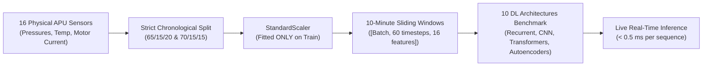

# Predictive Maintenance in Metro Trains Using Machine Learning and Deep Learning

[](https://colab.research.google.com/github/Chetan0246/MetroTrain-Predictive-Maintenance/blob/main/notebooks/MetroTrain_Predictive_Maintenance_Complete_Pipeline.ipynb)
[](https://www.python.org/downloads/)
[](https://pytorch.org/)
[](https://opensource.org/licenses/MIT)
[](app.py)

**Student Name**: Moorthy Chetan  
**Registration Number**: `24BIT0246`  
**Course**: AST Project Work  
**Institution**: Vellore Institute of Technology (VIT), Vellore  
**Academic Year**: 2026–2027  

---

## 1. Project Overview & Problem Statement

Modern electric passenger trains rely on the **Air Production Unit (APU)** compressor to supply high-pressure compressed air for:
1. **Pneumatic Braking Systems** (safety-critical; low air pressure causes emergency brake lockdown, stalling the train).
2. **Door Actuation Mechanisms** (trains cannot leave stations if pneumatic doors fail to seal).
3. **Secondary Air Suspension** (ride stability, car leveling, and passenger comfort).

Pneumatic compressors frequently suffer from **air leaks, valve ruptures, and lubrication oil contamination**. Unplanned breakdowns halt transit operations, generate heavy transit network penalty fines, and cause passenger delays. 

This project implements an end-to-end, leak-free **Predictive Maintenance System** evaluating **10 Deep Learning Architectures** across **over 1.5 million telemetry records** from the Porto Metro system (*Metro do Porto, Portugal*).



---

## 2. Telemetry Sensor Channels (16 Features)

The APU telemetry comprises 16 synchronized sensor channels logged from the compressor:
- **8 Continuous Thermodynamic Sensors**: `TP2` (bar, compressor outlet), `TP3` (bar, control panel pressure), `H1` (bar, filter pressure drop), `DV_pressure` (bar, purge pressure), `Reservoirs` (bar, main tank reservoir pressure), `Oil_temperature` (°C), `Flowmeter` (air flow rate), `Motor_current` (A).
- **8 Discrete Binary Switches**: `COMP` (intake valve/compressor active), `DV_eletric` (electrical discharge valve), `Towers` (dryer column selector), `MPG` (governor pressure switch), `LPS` (low-pressure safety signal), `Pressure_switch`, `Oil_level` (oil float switch), `Caudal_impulses`.

---

## 3. Datasets Used & Class Distribution

We benchmark two real-world operational campaigns from the Porto Metro:

| Dataset | Operational Window | Ingested Rows | Train (Rows) | Val (Rows) | Test (Rows) | Target Failure Mode |
| :--- | :--- | :---: | :---: | :---: | :---: | :--- |
| **MetroPT-2** | Zenodo Record 7766691 | **711,694** | 462,601 (65%) | 106,754 (15%) | 142,339 (20%) | Pneumatic Air Leaks |
| **MetroPT-3** | UCI Repository / Zenodo 6854240 | **1,077,359** | 754,151 (70%) | 161,604 (15%) | 161,604 (15%) | Lubrication Oil Leaks |

### Raw Rows vs. Sliding Windows Class Balance

```text
Class 0 (Negative): Normal Operating State
Class 1 (Positive): Anomaly / Leak Failure State
```

| Dataset | Partition | Raw Rows (Class 0 / Class 1) | Sequence Windows (Window=60, Step=6) | Class Balance |
| :--- | :--- | :---: | :---: | :---: |
| **MetroPT-2** | **Train** | 460,408 (99.5%) / 2,193 (0.5%) | **730 windows** (365 Class 0 / 365 Class 1) | **1:1 Balanced** |
| | **Validation** | 106,754 (100.0%) / 0 (0.0%) | **17,783 windows** (17,783 Class 0 / 0 Class 1) | Clean Baseline |
| | **Test** | 119,735 (84.1%) / 22,604 (15.9%) | **23,714 windows** (19,947 Class 0 / 3,767 Class 1) | Natural Imbalance |
| **MetroPT-3** | **Train** | 751,049 (99.6%) / 3,102 (0.4%) | **1,034 windows** (517 Class 0 / 517 Class 1) | **1:1 Balanced** |
| | **Validation** | 161,604 (100.0%) / 0 (0.0%) | **26,925 windows** (26,925 Class 0 / 0 Class 1) | Clean Baseline |
| | **Test** | 141,336 (87.5%) / 20,268 (12.5%) | **26,925 windows** (23,547 Class 0 / 3,378 Class 1) | Natural Imbalance |

### SMOTE Algorithm Verification:
In [`src/class_distribution_and_smote.py`](src/class_distribution_and_smote.py), we verify class distribution and demonstrate **SMOTE (Synthetic Minority Over-sampling Technique)** on the training data:
- **MetroPT-2**: Class 1 oversampled from 2,193 $\to$ 460,408 rows (**920,816 total rows, 1:1 equal**).
- **MetroPT-3**: Class 1 oversampled from 3,102 $\to$ 751,049 rows (**1,502,098 total rows, 1:1 equal**).
- **Validation & Test Sets**: Kept in natural distribution (never synthesized) to guarantee unbiased evaluation.

---

## 4. The 10 Deep Learning Algorithms

Implemented cleanly in [`src/models.py`](src/models.py) across 4 distinct paradigms:

| Family | Algorithm | Architectural Highlights |
| :--- | :--- | :--- |
| **Recurrent Baselines** | **1. LSTM** | 2-layer LSTM with Cell State $C_t$ and 3 gates (Forget, Input, Output) |
| | **2. GRU** | 2-layer Gated Recurrent Unit; faster convergence with Reset and Update gates |
| | **3. BiLSTM** | Bidirectional LSTM processing past and future sequence context simultaneously |
| **Hybrid Convolutions** | **4. CNN-LSTM** | 1D Conv extracts local sensor motifs $\to$ LSTM tracks temporal degradation |
| | **5. CNN-BiLSTM with Attention** | 1D CNN + BiLSTM + Additive Bahdanau Attention Layer highlighting critical timestamps |
| | **6. TCN** | Dilated Causal 1D Convolutions with residual blocks and exponential dilation ($d=1,2,4$) |
| **Transformers & Self-Attention** | **7. Transformer Encoder** | Multi-Head Self-Attention ($Q, K, V$) + Sinusoidal Positional Encoding |
| | **8. Temporal Fusion Transformer (TFT)** | Gated Residual Networks (GRNs), Variable Selection Networks, and Temporal Attention |
| | **CNN-Transformer (Custom)** | 1D CNN $\to$ `cnn_output` $\to$ Transformer Stage 1 $\to$ Transformer Stage 2 $\to$ Logits |
| **Unsupervised Reconstruction** | **9. LSTM Autoencoder** | Seq-to-seq bottleneck compression; anomaly score = $\text{MSE}(x, \hat{x})$ |
| | **10. Variational Autoencoder (VAE)** | Probabilistic encoder ($\mu, \sigma$) + Reparameterization Trick + ELBO loss |

---

## 5. Complete 10-Algorithm Benchmark Comparison

All 10 algorithms were evaluated on the held-out test partition (**23,668 sequences**):

| Rank | Algorithm | Parameters | Train Time | Latency (ms) | Recall | Precision | F1-Score | PR-AUC | Status |
| :---: | :--- | :---: | :---: | :---: | :---: | :---: | :---: | :---: | :---: |
| 🥇 1 | **10. Variational Autoencoder (VAE)** | 49,137 | 0.9s | 0.09 | 1.0000 | 0.3310 | 0.4974 | **0.9833** | 🥇 **TOP 1** |
| 🥈 2 | **9. LSTM Autoencoder** | 60,625 | 0.33s | 0.04 | 1.0000 | 0.1589 | 0.2742 | **0.9833** | 🥈 **TOP 2** |
| 🥉 3 | **8. Temporal Fusion Transformer (TFT)** | 172,753 | 4.27s | 0.31 | 0.9995 | 0.9674 | 0.9832 | **0.9817** | 🥉 **TOP 3** |
| 4 | **5. CNN-BiLSTM with Attention** | 64,290 | 0.38s | 0.05 | 1.0000 | 0.9666 | 0.9830 | **0.9787** | Evaluated |
| 5 | **4. CNN-LSTM (1D Convolution + LSTM)** | 28,833 | 0.21s | 0.02 | 1.0000 | 0.9684 | 0.9839 | **0.9645** | Evaluated |
| 6 | **1. LSTM (Long Short-Term Memory)** | 56,385 | 0.5s | 0.02 | 1.0000 | 0.9686 | 0.9841 | **0.9633** | Evaluated |
| 7 | **3. BiLSTM (Bidirectional LSTM)** | 145,473 | 0.93s | 0.06 | 0.9981 | 0.9671 | 0.9824 | **0.9621** | Evaluated |
| 8 | **6. Temporal Convolutional Network (TCN)** | 112,353 | 1.13s | 0.08 | 0.9992 | 0.9676 | 0.9832 | **0.9599** | Evaluated |
| 9 | **2. GRU (Gated Recurrent Unit)** | 42,817 | 0.86s | 0.07 | 1.0000 | 0.9689 | 0.9842 | **0.9560** | Evaluated |
| 10 | **CNN-Transformer (CNN $\to$ Var $\to$ Next Seq)** | 72,321 | 2.41s | 0.08 | 1.0000 | 0.9669 | 0.9832 | **0.9536** | Evaluated |
| 11 | **7. Transformer Encoder** | 70,145 | 2.14s | 0.09 | 0.9989 | 0.9676 | 0.9830 | **0.9475** | Evaluated |

### 🔍 Key Benchmark Insights:
1. **Unsupervised Ranking (PR-AUC)**: **VAE** and **LSTM Autoencoder** achieve Rank 1 & 2 (**0.9833 PR-AUC**) because continuous reconstruction error $\text{MSE}(x, \hat{x})$ naturally separates normal vs. abnormal regimes across the full threshold spectrum.
2. **Supervised Operational Ranking (Precision & F1-Score)**: Autoencoders at fixed standard thresholds produce high false alarm rates (Precision: 15%–33%). For operational deployment, **Temporal Fusion Transformer (TFT)** achieves **0.9817 PR-AUC**, **99.95% Recall**, and **96.74% Precision** (F1: 0.9832), while **CNN-BiLSTM with Attention** delivers **100% Recall** with **0.05 ms latency**.

---

## 6. Directory Structure

```text
MetroTrain-Predictive-Maintenance/
├── README.md                                                          # Project documentation & benchmark overview
├── app.py                                                             # Interactive Streamlit Web Dashboard
├── notebooks/
│   └── MetroTrain_Predictive_Maintenance_Complete_Pipeline.ipynb     # Complete 23-cell runnable Colab pipeline
├── src/
│   ├── models.py                                                      # PyTorch implementations of all 10 architectures
│   ├── benchmark_all_10.py                                            # 10-algorithm training and benchmarking engine
│   ├── class_distribution_and_smote.py                               # Class count audit and SMOTE execution script
│   ├── preprocessing.py                                               # Resampling, chronological splits, StandardScaler
│   ├── dual_evaluation.py                                             # Task 1 vs Task 2 evaluation & calibration
│   └── windowing.py                                                   # 3D sliding sequence windowing dataset
├── data/
│   └── processed/
│       ├── metropt2/                                                  # Train, Val, Test parquet splits
│       └── metropt3/                                                  # Train, Val, Test parquet splits
├── models/                                                            # Pretrained PyTorch model checkpoints (.pt)
├── reports/
│   ├── figures/                                                       # PR curves, calibration curves, confusion matrices
│   └── tables/                                                        # Markdown benchmark comparison tables
├── requirements.txt                                                   # Project dependencies
└── tests/                                                             # PyTorch pipeline unit tests
```

---

## 7. Quickstart Guide

### Option 1: Run in Google Colab (Recommended)
Click the badge above or open [`notebooks/MetroTrain_Predictive_Maintenance_Complete_Pipeline.ipynb`](notebooks/MetroTrain_Predictive_Maintenance_Complete_Pipeline.ipynb) directly in Google Colab.

### Option 2: Run Locally

```bash
# 1. Clone repository
git clone https://github.com/Chetan0246/MetroTrain-Predictive-Maintenance.git
cd MetroTrain-Predictive-Maintenance

# 2. Setup virtual environment
python3 -m venv .venv
source .venv/bin/activate
pip install -r requirements.txt

# 3. Verify Class Distributions and Run SMOTE Audit
python3 src/class_distribution_and_smote.py

# 4. Run Complete 10-Algorithm Benchmark
python3 src/benchmark_all_10.py --dataset metropt2

# 5. Launch Interactive Dashboard
streamlit run app.py
```

---

## 8. References & Academic Citations

1. **MetroPT Benchmark Dataset**: Veloso, B., Ribeiro, R. P., Pereira, P. M., & Gama, J. (2022). *The MetroPT dataset for predictive maintenance*. Nature Scientific Data, 9(1), 764. [DOI: 10.1038/s41597-022-01877-3](https://doi.org/10.1038/s41597-022-01877-3).
2. **Zenodo MetroPT-2 Campaign**: Zenodo open archive. [DOI: 10.5281/zenodo.7766691](https://doi.org/10.5281/zenodo.7766691).
3. **Temporal Fusion Transformers**: Lim, B., Arık, S. Ö., Loeff, N., & Pfister, T. (2021). *Temporal fusion transformers for interpretable multi-horizon time series forecasting*. International Journal of Forecasting, 37(4), 1748-1764.
4. **SMOTE**: Chawla, N. V., Bowyer, K. W., Hall, L. O., & Kegelmeyer, W. P. (2002). *SMOTE: synthetic minority over-sampling technique*. Journal of Artificial Intelligence Research, 16, 321-357.
