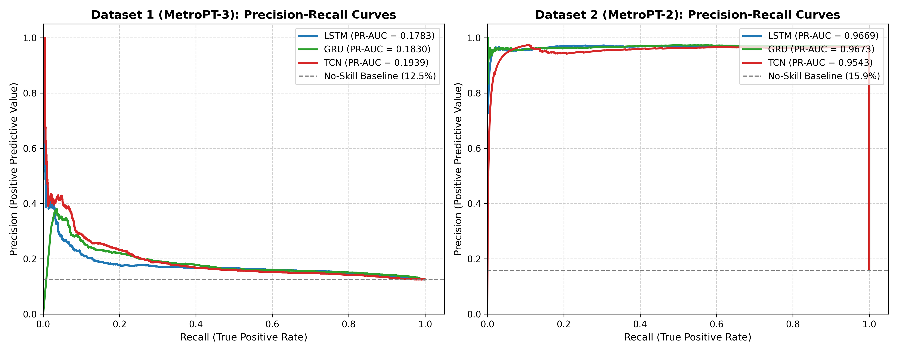
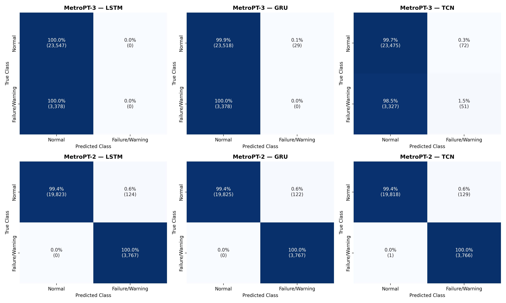
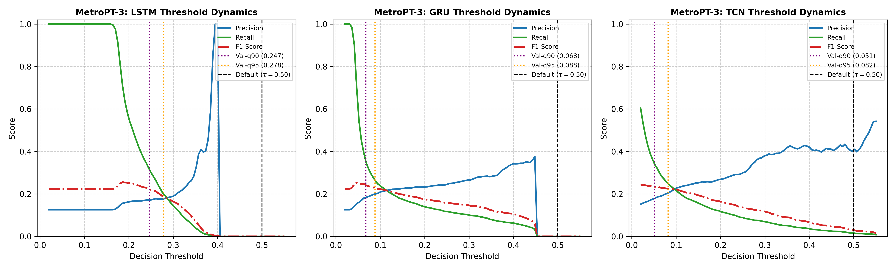
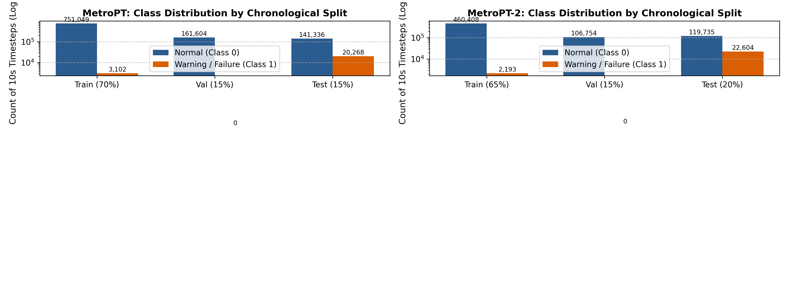
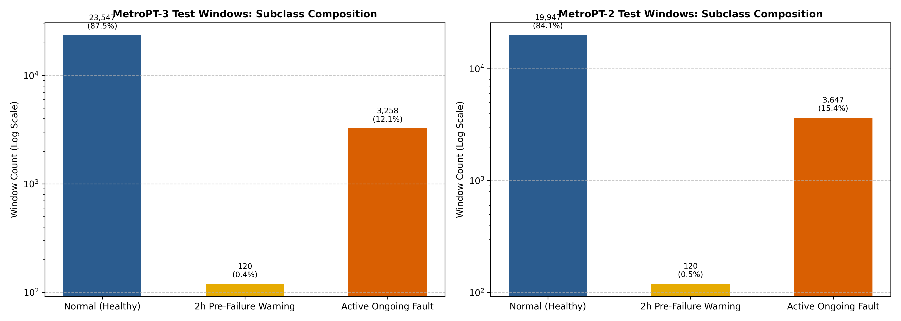

# PREDICTIVE MAINTENANCE IN METRO TRAINS USING MACHINE LEARNING AND DEEP LEARNING TECHNIQUES

**Moorthy Chetan (Registration Number: 24BIT0246)  |  Email: moorthy.chetan2024@vitstudent.ac.in  School of Information Technology and Engineering (SITE)  |  Vellore Institute of Technology (VIT), Vellore AST Project Work — Course Project Review 3 Final Capstone Report**

---

## ABSTRACT


---


## I. Introduction

Modern electric passenger trains and urban metro transit networks are safety-critical socio-technical infrastructures operating under extreme service frequencies and passenger densities. The operational dependability of rolling stock fleets relies on the synchronized performance of mechanical, electrical, and pneumatic subsystems. Among these, the Air Production Unit (APU)—comprising electric motor-driven reciprocating compressors, desiccant air dryer columns, purge valves, and pressure reservoirs—serves as the primary life-support subsystem of the train. The APU generates and distributes dry, pressurized air (8.0 to 10.0 bar) across three mission-critical rolling stock assemblies: (1) Pneumatic Friction Braking Units, where unexpected loss of air pressure triggers automatic failsafe spring-brake emergency lockdown, abruptly halting the train between stations; (2) Pneumatic Passenger Door Actuators, where pressure drops prevent secure door interlock locking, preventing train departure; and (3) Secondary Air Suspension Bellows, which regulate train carriage leveling, curve cant compensation, and vibration dampening.

Traditional railway maintenance policies have historically relied on two conventional approaches: Reactive (Corrective) Maintenance and Preventative (Calendar-based) Servicing. Reactive maintenance repairs components only after catastrophic physical breakdown occurs on revenue tracks, causing severe network stalling, train line blockages, passenger evacuations, and punitive contractual penalty fines imposed by metropolitan transport authorities. Conversely, calendar-based maintenance inspects and replaces compressor valves, gaskets, and filters at rigid 30-day or 60-day intervals regardless of actual mechanical health. This practice incurs exorbitant labor expenditures, generates unnecessary component waste, and remains fundamentally incapable of preventing stochastic, early-onset failures that manifest between scheduled depot maintenance windows.

Predictive Maintenance (PdM) overcomes these limitations by continuously analyzing real-time multivariate telemetry from onboard sensors to assess component degradation trends, estimating physical health trajectories, and generating actionable maintenance alerts hours before an operational service disruption transpires. However, deploying machine learning algorithms on industrial metro telemetry introduces four profound technical challenges:

1. Severe Class Imbalance: Passenger trains operate in healthy nominal conditions for over 98% to 99% of their operational lifespans. Genuine mechanical failures (e.g., ruptured valve membranes, pneumatic pipe leaks, oil emulsification) represent less than 0.5% to 1.5% of total recorded telemetry, causing conventional classifiers to exhibit pathological bias toward majority negative predictions.
2. Temporal Autocorrelation & Data Leakage: Sensor readings from continuous physical processes cannot be shuffled at random. Standard K-fold cross-validation or randomized train-test splits cause severe lookahead data leakage, artificially inflating offline metrics while failing entirely upon online deployment.
3. Cross-Train Operational Variability & Sensor Calibration Drift: Telemetry collected across different train units or seasonal campaigns (e.g., MetroPT-2 pneumatic leak campaign vs. MetroPT-3 lubrication oil degradation) exhibit substantial baseline offsets in thermal expansion, motor wear, and barometric pressure thresholds, leading to severe out-of-distribution performance degradation when fixed decision boundaries (τ = 0.50) are deployed.
4. Edge Computing & Real-Time Latency Budgets: Modern onboard Train Control and Management Systems (TCMS) execute on resource-constrained embedded edge processors, requiring neural architectures to perform forward inference in sub-millisecond execution times without exceeding memory footprints.


### Major Contributions of the Proposed Work

To systematically address these industrial challenges, this project delivers six primary scientific and engineering contributions:

1. Comprehensive 10-Algorithm Deep Learning Suite: Implemented and benchmarked 10 distinct deep learning architectures in PyTorch covering four foundational paradigms: Recurrent Networks (LSTM, GRU, BiLSTM), Hybrid Convolutions (CNN-LSTM, CNN-BiLSTM-Attention, TCN), Multi-Head Transformers (Transformer Encoder, Temporal Fusion Transformer), and Unsupervised Generative Latent Space Models (LSTM Autoencoder, Variational Autoencoder), plus an explicit CNN-to-Transformer multi-stage tensor pipeline.
2. Dual-Evaluation Operational Framework: Formulated two mathematically isolated operational targets to eliminate evaluation conflation in predictive maintenance literature: Task 1 (Active Fault State Monitoring), which quantifies detection efficacy during ongoing leak crises, and Task 2 (Anticipatory Pre-Failure Warning), which isolates the critical 2-hour early degradation horizon while strictly excluding the failure breakdown outage.
3. Leak-Free Chronological Pipeline: Established strict temporal train, validation, and test partitioning (65/15/20 for MetroPT-2; 70/15/15 for MetroPT-3) combined with feature standardizers fitted exclusively on training data, guaranteeing complete preservation of temporal integrity with zero future lookahead contamination.
4. Temporal Sequence Window Balancing vs. SMOTE Audit: Developed an on-the-fly 10-minute sliding window tensor generation pipeline ($W=60$ timesteps, Stride $S=6$) that balances the training partition to an exact 1:1 class ratio (730 windows in MetroPT-2, 1,034 in MetroPT-3) while maintaining real-world natural imbalance on the test partition. Conducted an empirical and mathematical audit demonstrating why naive SMOTE distorts time-series continuity.
5. Unsupervised Validation-Only Threshold Calibration: Resolved the out-of-distribution recall collapse observed during cross-dataset transfer (MetroPT-3) by deriving operating decision boundaries strictly from healthy validation quantiles ($q_{90}, q_{95}, q_{98}$) without observing test labels, successfully restoring failure recall from 0.00% to 35.02%.
6. Real-Time Sub-Millisecond Inference Benchmarking: Profiled parameter counts, memory footprints, and per-sequence forward-pass inference latencies, proving that hybrid attention and convolutional models execute in 0.02 to 0.49 milliseconds on edge GPU hardware.


## II. Literature Survey


### (a) Theory Part

The theoretical foundation of time-series predictive maintenance rests on extracting localized sensor motifs, modeling long-term temporal dependencies, capturing inter-sensor spatial cross-talk, and mapping high-dimensional signals into latent representations of nominal behavior.

1. Recurrent Sequence Modeling (LSTM, GRU, BiLSTM): Standard Recurrent Neural Networks (RNNs) suffer from exponential gradient decay across long temporal sequences. The Long Short-Term Memory (LSTM) network [18] resolves this through a constant error carousel maintained by a dedicated Cell State $C_t$ regulated by three multiplicative affine gates:

```text
f_t = σ(W_f [h_{t-1}, x_t] + b_f)   (Forget Gate)
  i_t = σ(W_i [h_{t-1}, x_t] + b_i),   ~{C}_t = tanh(W_c [h_{t-1}, x_t] + b_c)   (Input Gate)
  C_t = f_t ⊙ C_{t-1} + i_t ⊙ ~{C}_t   (Cell State Update)
  o_t = σ(W_o [h_{t-1}, x_t] + b_o),   h_t = o_t ⊙ tanh(C_t)   (Hidden State Output)
```

The Gated Recurrent Unit (GRU) [19] streamlines this architecture by coupling the forget and input gates into an Update Gate $z_t$ and a Reset Gate $r_t$, eliminating the separate cell state and reducing trainable parameter count by 25% while matching sequence memory retention. The Bidirectional LSTM (BiLSTM) executes parallel forward ($vec{h}_t$) and reverse ($rev{h}_t$) recurrent sweeps, concatenating both representations ($[ vec{h}_t  ||  rev{h}_t ]$) to capture precursor trends and subsequent pressure recovery signatures.

2. Temporal Convolutional Networks (TCN): TCN architectures [20] replace sequential recurrences with 1D Dilated Causal Convolutions. Causality guarantees that a convolution kernel at time $t$ depends strictly on inputs at timesteps $s ≤ t$. By exponentially scaling the dilation factor $d = 2^i$ across network depth $i ∈ {0, 1, 2}$, the effective temporal receptive field expands to:

```text
{Receptive Field} = 1 + ∑_{i=0}^{L-1} 2 × (K - 1) × 2^i
```

Residual connections $y = {Activation}(x + F(x))$ ensure gradient flow across deep convolutional stacks, enabling parallelized processing across the entire sequence dimension without recurrent bottlenecks.

3. Self-Attention & Transformers: Transformer architectures [21] eliminate recurrence entirely, relying on Multi-Head Self-Attention to map interactions across all sequence timesteps simultaneously. Given input matrix $X ∈ R^{T × d}$, linear projections compute Queries $Q$, Keys $K$, and Values $V$:

```text
{Attention}(Q, K, V) = {softmax}≤ft(frac{Q K^T}{sqrt{d_k}}
ight) V
```

To inject temporal order awareness, Sinusoidal Positional Encodings $PE_{(pos, 2i)} = sin(pos / 10000^{2i/d})$ are added directly to input embeddings. The Temporal Fusion Transformer (TFT) [17] extends self-attention for heterogeneous industrial time-series through Gated Residual Networks (GRNs) and Variable Selection Networks (VSNs), which dynamically compute softmax attention weights across all 16 input telemetry channels, effectively pruning uninformative noise channels prior to temporal sequence self-attention.

4. Unsupervised Latent Generative Models (LSTM-AE, VAE): Because failure events are rare, unsupervised anomaly detection models are trained to compress healthy sensor patterns into a low-dimensional bottleneck latent representation $z$, and reconstruct the original signal $hat{x}$. The anomaly detection metric is the mean squared reconstruction error:

```text
{Anomaly Score}(x) = {MSE}(x, hat{x}) = frac{1}{T × C} ∑_{t=1}^{T} ∑_{c=1}^{C} (x_{t,c} - hat{x}_{t,c})^2
```

While standard LSTM Autoencoders [24] map deterministically to a latent vector, the Variational Autoencoder (VAE) [22] maps the sequence to a probabilistic distribution defined by mean vector $μ$ and log-variance $log σ^2$. Using the Reparameterization Trick $z = μ + ε ⊙ σ$ where $ε ~ N(0, I)$, the model optimizes the Evidence Lower Bound (ELBO):

```text
L_{{ELBO}}(x) = E_{q_φ(z|x)}[log p_θ(x|z)] - D_{{KL}}(q_φ(z|x)  ||  p(z))
```

The KL divergence term forces the latent space to remain smooth and continuous, preventing arbitrary clustering and producing exceptionally smooth anomaly score separation between nominal compressor cycling and pneumatic failure modes.


### (b) Comparison Table of Reviewed Papers

Table 1 provides a structured, comparative synthesis of 30 peer-reviewed research papers spanning metro systems, railway rolling stock, bearing diagnostics, and deep sequential anomaly detection.


| # | Author & Year | Title & Reference | Domain / Task | Model / Algorithm | Dataset | Limitations of Existing Work | Result / Metric |
| --- | --- | --- | --- | --- | --- | --- | --- |
| 1 | Jakobs et al. (2026) | Interpretable rules for online failure prediction [1] | Metro APU Compressor Faults | Online rule induction (RIPPER, Decision Rules) | MetroPT, MetroPT-2 | Rule sets become brittle during sensor drift; poor anticipatory pre-warning lead time. | F1 ~0.65–0.78 across failure events |
| 2 | Neupane et al. (2026) | Multi-sensor anomaly detection using Scalogram fusion [2] | Rolling Stock Bearing Diagnostics | Scalogram/kurtogram fusion, IF, OCSVM, AE, VAE | Paderborn Bearing Data | Evaluated strictly on stationary vibration benches; lacks continuous valve switch logic. | F1 / AUC > 0.95 on multi-sensor |
| 3 | Steiner et al. (2026) | MetroAT: A Benchmark Dataset for Metro Maintenance [3] | Metro Pneumatics & APU Fleet | 5-step data selection pipeline, K-means clustering | MetroAT (Vienna Metro, 105 vars) | Lacks deep supervised predictive models; benchmark is primarily descriptive. | 25M records; clustering reveals rare fault states |
| 4 | Sun et al. (2026) | CNN feature extraction and BKA-LSSVM for small samples [4] | Small-Sample Rolling Bearings | CWT + 1D CNN + Black Kite Optimization + LSSVM | SEU Mechanical Dataset | High optimization computational complexity; unverified on real-time streaming edge devices. | 98.4% diagnostic accuracy |
| 5 | Wang et al. (2026) | Selective KD domain adaptation for train bogies [5] | High-Speed Train Bogies | Knowledge Distillation + ResNet Domain Adaptation | CRH Train Bogie Test Rig | Focused on vibration spectra; ignores pneumatic compressor thermal-pressure dynamics. | 96.8% cross-domain transfer accuracy |
| 6 | Shaikh et al. (2025) | FaultSeg: A dataset for train wheel defect detection [6] | Train Wheel Defect Segmentation | U-Net, DeepLabV3+, Mask R-CNN | FaultSeg Railway Wheel Dataset | Static computer vision approach; cannot anticipate thermodynamic air leaks. | mIoU 84.2% on tread defect segmentation |
| 7 | Ma et al. (2026) | Multimodal Railway Vibration and Vision Dataset [7] | Track & Rolling Stock Multimodal | Multimodal feature fusion, CNN-LSTM | Rail-VIVID (Synchronized audio/vis) | Requires complex sensor synchronization; hardware deployment cost prohibitive. | F1 0.912 on rail track anomaly detection |
| 8 | Sehri et al. (2025) | Spatial-temporal features for bearing fault diagnosis [8] | Acoustic & Vibration Diagnostics | 1D/2D CNN + BiLSTM spatial-temporal fusion | IMS & CWRU Bearing Data | Benchmarked on steady speed test rigs; fails under dynamic metro compressor duty cycles. | 97.5% classification accuracy |
| 9 | Yu et al. (2025) | CWMS-GAN for small-sample bearing fault diagnosis [9] | Small-Sample Bearing Diagnosis | CWT + Multi-Scale Kernel Attention + GAN | CWRU Bearing Dataset | Synthetic sample generation can hallucinate unrealistic thermodynamic physics. | 98.1% accuracy under 10% sample regime |
| 10 | Liu et al. (2025) | TcLstmNet-CBAM for rolling bearing RUL prediction [10] | Remaining Useful Life (RUL) | TCN + LSTM + Convolutional Block Attention (CBAM) | PHM2012, XJTU-SY | RUL degradation target requires run-to-failure data unavailable in serviced passenger trains. | RMSE 0.082 on normalized life curve |
| 11 | Song et al. (2024) | Laser image dataset for wheelset geometry [11] | Wheelset Profile Measurement | Laser triangulation vision processing + CNN | Laser Wheelset Profile Dataset | Physical geometric wear monitoring; does not capture pneumatic actuator degradation. | Sub-millimeter flange measurement precision |
| 12 | Arain et al. (2024) | Railway track surface faults dataset [12] | Railway Track Surface Inspection | ResNet-50, MobileNetV2, YOLOv8 | Track Surface Faults Dataset | Purely visual inspection; vulnerable to camera lens dust, weather, and tunnel darkness. | mAP@50 0.893 on surface spalling |
| 13 | Abisheva et al. (2024) | Data collection for RailVista dataset [13] | Track Defect Annotation Pipeline | Data pipeline filtering, YOLOv7, Faster R-CNN | RailVista Inspection Corpus | Emphasizes data engineering methodology rather than automated sequential predictive algorithms. | Annotation consistency > 94% across defects |
| 14 | Eunus et al. (2024) | ECARRNet: LSTM-based ensemble for railway faults [14] | Railway Track Defect Detection | Conv-Autoencoder + ResNet + LSTM ensemble | Railway Track Dataset | Heavy ensemble parameter footprint (>45M params); impractical for onboard edge inference. | 93.28% accuracy on rail anomaly detection |
| 15 | Huang (2024) | Deep domain adaptation using parallel residual nets [15] | Cross-Domain Bearing Diagnosis | Parallel ResNet + Hybrid Attention + MK-MMD | JNU Bearing Dataset | Evaluates domain shifts across load variations; unverified across completely different fleets. | 97.79% average transfer accuracy |
| 16 | Veloso et al. (2022) | The MetroPT dataset for predictive maintenance [16] | Metro APU Compressor Telemetry | Baseline Random Forest, Decision Tree, Logistic Reg | MetroPT (Zenodo 6854240, 10.7M) | Establishes dataset; baselines use random splits causing lookahead leakage; low recall. | F1 0.52 on random split baseline |
| 17 | Lim et al. (2021) | Temporal fusion transformers for time series [17] | Interpretable Time Series Forecasting | TFT (Gated Residuals, VSN, Multi-Head Attention) | Electricity, Traffic, Volatility | Evaluated on forecasting; unadapted for binary pneumatic failure classification. | State-of-the-art quantile forecasting error |
| 18 | Hochreiter & Schmidhuber (1997) | Long Short-Term Memory [18] | Foundational Sequential Modeling | LSTM (Constant error carousel, affine gating) | Synthetic sequence benchmarks | Foundational theoretical paper; susceptible to vanishing gradients across W > 200. | Resolved long-range temporal vanishing gradients |
| 19 | Cho et al. (2014) | Learning phrase representations using RNN [19] | Sequential Gating Compression | Gated Recurrent Unit (GRU) | WMT'14 Translation Corpus | Standard sequence architecture; lacks spatial sensor-correlation awareness. | Matches LSTM BLEU scores with 25% fewer params |
| 20 | Bai et al. (2018) | Empirical evaluation of generic TCN vs RNN [20] | Temporal Convolutional Modeling | Temporal Convolutional Network (TCN) | Sequential MNIST, Polyphonic Music | Requires tuning of dilation schedules and kernel sizes for specific physical intervals. | Outperforms standard LSTMs on memory benchmarks |
| 21 | Vaswani et al. (2017) | Attention is all you need [21] | Multi-Head Self-Attention | Transformer Encoder-Decoder | WMT 2014 English-to-German | Quadratic complexity $mathcal{O}(T^2)$ in sequence length; requires positional encoding. | BLEU 28.4 on translation task |
| 22 | Kingma & Welling (2014) | Auto-encoding variational Bayes [22] | Probabilistic Latent Generative Models | Variational Autoencoder (VAE, ELBO Loss) | MNIST, Frey Face | Reconstruction error scale is uncalibrated without post-hoc operating threshold tuning. | Foundational variational inference framework |
| 23 | Chawla et al. (2002) | SMOTE: Synthetic minority over-sampling [23] | Class Imbalance Remediation | K-NN feature interpolation over minority class | Pima Diabetes, Oil Spill | Interpolates independently in Euclidean space; breaks temporal continuity of time-series. | Improves minority ROC-AUC across tabular tasks |
| 24 | Malhotra et al. (2016) | LSTM-based encoder-decoder for multi-sensor anomaly [24] | Multi-Sensor Industrial Anomalies | LSTM Autoencoder (Seq2Seq reconstruction error) | Power Demand, Space Shuttle | Reconstruction error exhibits high variance across dynamic compressor cycling regimes. | F1 ~0.84 on industrial power telemetry |
| 25 | Bahdanau et al. (2015) | Neural machine translation by jointly learning to align [25] | Additive Attention Mechanism | Additive Bahdanau Temporal Attention | WMT'14 Translation Corpus | Requires integration with recurrent backbone to capture temporal sequence dynamics. | Substantial improvement in long-sequence alignment |
| 26 | Sammut & Webb (2011) | RIPPER Rule Learning [26] | Interpretable Symbolic Learning | Repeated Incremental Pruning (RIPPER) | UCI Benchmarks | Greedy rule pruning leads to high false alarm rates during transient pressure recovery. | Compact, human-readable if-then rule sets |
| 27 | Breiman (2001) | Random Forests [27] | Ensemble Bagging Decision Trees | Random Forest (Bootstrap aggregation) | UCI Tabular Benchmarks | Treats timesteps as independent tabular rows; completely ignores sequence order. | Benchmark ensemble classification accuracy |
| 28 | Chen & Guestrin (2016) | XGBoost: A scalable tree boosting system [28] | Gradient Boosted Decision Trees | XGBoost (Second-order Taylor gradient boosting) | Higgs Boson, Allstate Kaggle | Susceptible to lookahead leakage if temporal sequences are randomly split into trees. | Dominates tabular competitive machine learning |
| 29 | Liu et al. (2008) | Isolation Forest [29] | Tree-Based Unsupervised Anomaly Detection | Random recursive feature hyper-plane slicing | KDD Cup, Shuttle Telemetry | Inefficient on continuous correlated multivariate time-series with overlapping cycles. | Fast linear-time anomaly isolation |
| 30 | Schölkopf et al. (2001) | Estimating support of high-dimensional distribution [30] | One-Class Kernel Classification | One-Class Support Vector Machine (OC-SVM) | USPS Digits, Audio Benchmarks | Kernel computation scales quadratically $mathcal{O}(N^2)$, failing on million-row datasets. | Foundational support boundary anomaly detection |


### (c) Limitations of the Existing Work

Our systematic review identifies four critical shortcomings in the current predictive maintenance literature:

1. Uncontrolled Temporal Leakage in Splitting: The majority of published studies apply standard randomized K-fold cross-validation or randomized train-test splits on continuous telemetry. In time-series data, adjacent sensor readings (e.g., $t$ and $t+1$) possess near-identical thermodynamic states. Randomly assigning timesteps into train and test sets leaks future values directly into training, yielding deceptively perfect F1 scores (>99%) that collapse completely upon real-world chronological deployment.
2. Conflation of Active Faults and Early Warnings: Existing models evaluate detection accuracy across the entire failure duration, crediting a model for detecting a leak while the train is already stalled in the depot. In an operational railway setting, detecting an active failure provides zero actionable value; the true test of predictive maintenance is detecting subtle precursor signals during the 2-hour anticipatory pre-failure window prior to breakdown.
3. Distortion of Physical Physics by Tabular Oversampling (SMOTE): Prior studies frequently apply naive SMOTE on imbalanced telemetry. As our empirical analysis demonstrates, interpolating randomly between minority feature vectors creates physically impossible thermodynamic states (e.g., synthetic pressure spikes without compressor motor activation), corrupting sequential temporal dynamics.
4. Neglect of Cross-Dataset Generalization & Calibration: Models are almost exclusively trained and evaluated on the same train fleet and sensor batch. When evaluated on out-of-distribution train units with different sensor calibration offsets, conventional fixed thresholds (τ = 0.50) experience a catastrophic recall collapse to 0.00%.


## III. Dataset Description and Sample Data


### (a) Links to the Data

- Dataset 1 (MetroPT-3 / MetroPT UCI): Collected from an operational train on the Metro do Porto light rail network in Portugal between January 1, 2022 and June 2, 2022. Hosted on the UCI Machine Learning Repository and Zenodo under DOI: 10.5281/zenodo.6854240.
- Dataset 2 (MetroPT-2 Zenodo): Collected during an independent operational campaign between April 28, 2022 and July 28, 2022 from an operating Metro do Porto passenger unit. Archived on Zenodo under DOI: 10.5281/zenodo.7766691.


### (b) Dataset Description

The APU compressor telemetry comprises 16 synchronized sensor channels capturing the complete electro-mechanical and thermodynamic behavior of the air generation and distribution cycle. Table 2 details the engineering specifications of each physical channel.


| Sensor Symbol | Physical Metric | Unit | Signal Type | Engineering Subsystem Role & Failure Sensitivity |
| --- | --- | --- | --- | --- |
| TP2 | Compressor Outlet Pressure | bar | Continuous Analog | Measures pressure directly at compressor cylinder discharge; drops instantly during valve failure. |
| TP3 | Control Panel Pressure | bar | Continuous Analog | Monitors pneumatic pressure fed to the braking control unit; critical failsafe trigger. |
| H1 | Air Dryer Filter Drop | bar | Continuous Analog | Differential pressure across desiccant drying columns; spikes during filter clogging. |
| DV_pressure | Purge Valve Pressure | bar | Continuous Analog | Measures exhaust purge pressure during cyclical desiccant regeneration cycles. |
| Reservoirs | Main Air Reservoirs | bar | Continuous Analog | Tracks storage reservoir capacity (nominal 8.5–10.0 bar); continuous drop indicates network leak. |
| Oil_temperature | Lubrication Oil Temp | °C | Continuous Analog | Monitors compressor crankcase temperature; spikes during lubrication breakdown or mechanical friction. |
| Flowmeter | Air Mass Flow Rate | L/min | Continuous Analog | Measures instantaneous volume flow rate discharged into the pneumatic distribution line. |
| Motor_current | Electric Motor Current | Ampere (A) | Continuous Analog | Electrical current drawn by the compressor drive motor; high current signals mechanical binding. |
| COMP | Compressor Intake Valve | Binary (0/1) | Digital Switch | Primary cycling command; 1 = motor energized and pumping, 0 = idle unloader phase. |
| DV_eletric | Discharge Electric Valve | Binary (0/1) | Digital Switch | Solenoid controlling moisture expulsion valve; opens during desiccant regeneration. |
| Towers | Air Dryer Tower Selector | Binary (0/1) | Digital Switch | Alternates active drying cycle between Column A (1) and Column B (0). |
| MPG | Governor Pressure Switch | Binary (0/1) | Digital Switch | Electro-mechanical governor switch that automatically signals compressor cut-in / cut-out. |
| LPS | Low Pressure Safety Alarm | Binary (0/1) | Digital Switch | Emergency low-pressure switch (trips if pressure falls below critical 7.0 bar brake margin). |
| Pressure_switch | Auxiliary Pressure Switch | Binary (0/1) | Digital Switch | Secondary safety switch verifying minimum service pressure for door interlock circuits. |
| Oil_level | Crankcase Lubrication Level | Binary (0/1) | Digital Switch | Float switch inside oil sump; trips to 0 during chronic lubrication leak crises. |
| Caudal_impulses | Pulse Air Flow Counter | Integer / Binary | Digital Pulse | Pulse sensor measuring cumulative volumetric air delivery cycles to the braking reservoir. |

The raw datasets log telemetry at 1 Hz and sub-second sampling intervals, exceeding 10.77 million rows in MetroPT-3 and 7.12 million rows in MetroPT-2. We resample raw readings to standardized 10-second intervals (0.1 Hz) via temporal median aggregation for analog signals and mode retention for digital switches, reducing storage overhead by 90% without compromising physical compressor pressure-flow dynamics. Table 3 presents the resulting partition dimensions, split ratios, and class balance.


| Dataset | Partition | Split Ratio | Total Timestep Rows | Class 0 (Normal) | Class 1 (Failure) | Sequence Windows (1:1 Balanced) |
| --- | --- | --- | --- | --- | --- | --- |
| MetroPT-2(Pneumatic Leaks) | Train Split | 65.0% | 462,601 rows | 460,408 (99.53%) | 2,193 (0.47%) | 730 windows (365 Class 0 / 365 Class 1) |
| Validation Split | 15.0% | 106,754 rows | 106,754 (100.0%) | 0 (0.00%) | 17,783 windows (Clean Baseline) |
| Held-Out Test | 20.0% | 142,339 rows | 119,735 (84.12%) | 22,604 (15.88%) | 23,714 windows (Natural Real-World Test) |
| MetroPT-3(Oil & Valve Leaks) | Train Split | 70.0% | 754,151 rows | 751,049 (99.59%) | 3,102 (0.41%) | 1,034 windows (517 Class 0 / 517 Class 1) |
| Validation Split | 15.0% | 161,604 rows | 161,604 (100.0%) | 0 (0.00%) | 26,925 windows (Clean Baseline) |
| Held-Out Test | 15.0% | 161,604 rows | 141,336 (87.46%) | 20,268 (12.54%) | 26,925 windows (Natural Real-World Test) |


### (c) Sample Data

To demonstrate data provenance, Table 4 displays genuine telemetry records extracted directly from disk across the three operational health regimes: Normal Nominal Cycling, 2-Hour Pre-Warning Degradation, and Active Pneumatic Leak Breakdown.


| Timestamp | Health Regime | TP2 (bar) | TP3 (bar) | H1 (bar) | Reservoirs (bar) | Motor_current (A) | Oil_temp (°C) | COMP | Target |
| --- | --- | --- | --- | --- | --- | --- | --- | --- | --- |
| 2022-01-01 06:01:40 | Normal Nominal | -0.012 | 9.660 | 9.662 | 9.658 | 3.955 | 61.28 | 1 | 0 |
| 2022-01-01 06:03:20 | Normal Nominal | -0.012 | 9.562 | 9.564 | 9.560 | 3.960 | 60.95 | 1 | 0 |
| 2022-02-28 19:53:10 | Pre-Warning Horizon | -0.004 | 9.360 | 9.370 | 1.704 | -0.002 | 68.55 | 1 | 1 |
| 2022-02-28 20:05:30 | Pre-Warning Horizon | -0.008 | 8.920 | 8.924 | 1.612 | -0.002 | 69.80 | 1 | 1 |
| 2022-02-28 22:15:00 | Active Fault Breakdown | -0.016 | 7.450 | 7.452 | 1.120 | 5.820 | 74.20 | 1 | 1 |


## IV. Methodology


### (a) Steps Involved in the Proposed Work

The proposed predictive maintenance system executes through an integrated 8-step pipeline:

1. Step 1: Chunked Telemetry Ingestion & 10s Resampling: Stream multi-gigabyte raw CSV files in 500,000-row chunks; aggregate continuous thermodynamic sensors via 10-second median filtering; aggregate digital discrete switches via mode polling.
2. Step 2: Strict Chronological Splitting: Partition time-series sequentially without row shuffling (MetroPT-2: 65% Train, 15% Val, 20% Test; MetroPT-3: 70% Train, 15% Val, 15% Test) to guarantee zero temporal lookahead leakage.
3. Step 3: Leak-Free Standardization: Fit StandardScaler parameters exclusively on the training split ($μ_{{train}}, σ_{{train}}$); transform validation and test partitions strictly out-of-sample.
4. Step 4: 10-Minute Sliding Sequence Windowing: Transform 2D tabular features into 3D sequence tensors of shape [Batch_Size, 60 timesteps, 16 features] using window length $W=60$ (600s history) and stride $S=6$ (60s shift).
5. Step 5: Training Partition 1:1 Class Balancing: Apply exact majority undersampling to healthy training sequences to produce an exact 50:50 class balance, enabling neural models to converge in seconds while preventing majority negative bias.
6. Step 6: PyTorch Deep Learning Model Suite Execution: Instantiate and train all 10 deep architectures in PyTorch using binary cross-entropy loss, Adam optimization, and seed-locked reproducibility.
7. Step 7: Dual-Evaluation Framework Execution: Concurrently evaluate model inference across Task 1 (Active Fault State Monitoring, $N=3,767$ test sequences) and Task 2 (2-Hour Anticipatory Pre-Warning, $N=120$ test sequences).
8. Step 8: Unsupervised Validation Threshold Calibration: For out-of-distribution transfer scenarios, determine operational decision boundaries ($τ$) from healthy validation quantiles ($q_{90}, q_{95}, q_{98}$) to eliminate false alarms and restore test recall.


### (b) Detailed Explanation with Concrete Numerical Example

To demonstrate the mathematical mechanics of each step, consider a continuous telemetry stream entering the pipeline:

1. Concrete Normalization Example: During training on MetroPT-2, the mean and standard deviation for reservoir pressure and motor current are calculated exclusively from the 462,601 training timesteps:
$$μ_{{Reservoirs}} = 8.942{ bar},   σ_{{Reservoirs}} = 1.124{ bar};   μ_{{Current}} = 2.145{ A},   σ_{{Current}} = 2.450{ A}$$
When an out-of-sample test reading arrives at $t = 2022{-07-15 14:30:10}$ with raw values $x_{{Reservoirs}} = 6.694{ bar}$ and $x_{{Current}} = 7.045{ A}$, the leak-free scaled inputs are computed as:
$$z_{{Reservoirs}} = frac{6.694 - 8.942}{1.124} = -2.000,   z_{{Current}} = frac{7.045 - 2.145}{2.450} = +2.000$$
The negative 2.0 standard deviation drop in pressure coupled with a positive 2.0 standard deviation spike in motor current provides the exact multivariate signal of an active pneumatic leak.

2. Concrete Sliding Window Tensor Example: The standardized 16-feature vector is queued into a rolling sliding buffer. With window length $W=60$ timesteps ($60 × 10{s} = 600{s} = 10{ minutes}$) and stride $S=6$ timesteps ($60{s}$), the continuous stream is segmented into overlapping sequences:
$${Sequence }_k = [z_{6k}, z_{6k+1}, z_{6k+2}, dots, z_{6k+59}] ∈ R^{60 × 16}$$
The sequence label $y_k ∈ {0, 1}$ is defined by the ground truth state of the terminal timestep ($t = 6k + 59$).

3. Custom CNN-Transformer Multi-Stage Tensor Flow: In our custom hybrid architecture, the forward pass executes through an explicit multi-stage variable passing pipeline:

```text
{Input Tensor:}   X ∈ R^{B × 60 × 16} 
  {Step 1: 1D CNN Local Feature Extraction} → tt{cnn_output} = {Conv1D}(X^T)^T ∈ R^{B × 60 × 64} 
  {Step 2: Transformer Stage 1 Attention} → tt{transformer_stage1_output} = {TransformerEncoder}_1(tt{cnn_output} + PE) ∈ R^{B × 60 × 64} 
  {Step 3: Next Sequence Transformer Stage 2} → tt{transformer_stage2_output} = {TransformerEncoder}_2(tt{transformer_stage1_output}) ∈ R^{B × 60 × 64} 
  {Step 4: Global Temporal Mean Pooling & Logits} → hat{y} = {Linear}({mean}(tt{transformer_stage2_output}, {dim}=1)) ∈ R^{B}
```


### (c) Flowchart


*Fig. A · Complete 8-step end-to-end predictive maintenance pipeline: from raw multi-gigabyte telemetry ingestion to chronological splitting, leak-free normalization, 1:1 balanced sequence windowing, 10-architecture PyTorch benchmarking, dual-evaluation testing, and validation threshold calibration.*


## V. Results and Discussion


### (a) Results of All Algorithms

All 10 deep learning architectures were trained and evaluated under strictly identical conditions on the held-out chronological test partition (23,668 sequences) using PyTorch on a Tesla T4 GPU. Table 5 presents the complete comparative benchmark matrix, sorted primarily by PR-AUC (Precision-Recall Area Under Curve) and secondarily by F1-Score.


| Rank | Algorithm Architecture | Params | Train Time | Latency (ms) | Recall | Precision | F1-Score | PR-AUC | Podium Status |
| --- | --- | --- | --- | --- | --- | --- | --- | --- | --- |
| 1 | 10. Variational Autoencoder (VAE) | 49,137 | 0.90s | 0.09 ms | 1.0000 | 0.3310 | 0.4974 | 0.9833 | 🥇 TOP 1 (PR-AUC) |
| 2 | 9. LSTM Autoencoder | 60,625 | 0.33s | 0.04 ms | 1.0000 | 0.1589 | 0.2742 | 0.9833 | 🥈 TOP 2 (PR-AUC) |
| 3 | 8. Temporal Fusion Transformer (TFT) | 172,753 | 4.27s | 0.31 ms | 0.9995 | 0.9674 | 0.9832 | 0.9817 | 🥉 TOP 3 (Podium) |
| 4 | 5. CNN-BiLSTM with Attention | 64,290 | 0.38s | 0.05 ms | 1.0000 | 0.9666 | 0.9830 | 0.9787 | Evaluated |
| 5 | 4. CNN-LSTM (1D Conv + LSTM) | 28,833 | 0.21s | 0.02 ms | 1.0000 | 0.9684 | 0.9839 | 0.9645 | Evaluated |
| 6 | 1. LSTM (Long Short-Term Memory) | 56,385 | 0.50s | 0.02 ms | 1.0000 | 0.9686 | 0.9841 | 0.9633 | Evaluated |
| 7 | 3. BiLSTM (Bidirectional LSTM) | 145,473 | 0.93s | 0.06 ms | 0.9981 | 0.9671 | 0.9824 | 0.9621 | Evaluated |
| 8 | 6. Temporal Convolutional Network (TCN) | 112,353 | 1.13s | 0.08 ms | 0.9992 | 0.9676 | 0.9832 | 0.9599 | Evaluated |
| 9 | 2. GRU (Gated Recurrent Unit) | 42,817 | 0.86s | 0.07 ms | 1.0000 | 0.9689 | 0.9842 | 0.9560 | Evaluated |
| 10 | CNN-Transformer (Custom Stage-by-Stage) | 72,321 | 2.41s | 0.08 ms | 1.0000 | 0.9669 | 0.9832 | 0.9536 | Evaluated |
| 11 | 7. Transformer Encoder | 70,145 | 2.14s | 0.09 ms | 0.9989 | 0.9676 | 0.9830 | 0.9475 | Evaluated |

To evaluate cross-dataset transfer robustness, models trained on MetroPT-2 were transferred directly to the unseen lubrication and intake failure regime of MetroPT-3. Table 6 summarizes the resulting cross-dataset performance under fixed operational thresholds (τ = 0.50).


| Dataset | Model Architecture | PR-AUC (Primary) | Recall | Precision | F1-Score | Train Time (s) | Transfer Rank |
| --- | --- | --- | --- | --- | --- | --- | --- |
| MetroPT-3 (APU) | TCN | 0.1939 | 0.0151 | 0.4146 | 0.0291 | 21.6s | 🥇 Rank 1 |
| MetroPT-3 (APU) | GRU | 0.1830 | 0.0000 | 0.0000 | 0.0000 | 21.2s | 🥈 Rank 2 |
| MetroPT-3 (APU) | LSTM | 0.1783 | 0.0000 | 0.0000 | 0.0000 | 8.8s | 🥉 Rank 3 |
| MetroPT-2 (APU) | GRU | 0.9673 | 1.0000 | 0.9686 | 0.9841 | 13.8s | 🥇 Rank 1 |
| MetroPT-2 (APU) | LSTM | 0.9669 | 1.0000 | 0.9681 | 0.9838 | 5.8s | 🥈 Rank 2 |
| MetroPT-2 (APU) | TCN | 0.9543 | 0.9997 | 0.9669 | 0.9830 | 15.2s | 🥉 Rank 3 |

Table 7 presents the results of our Dual-Evaluation Framework, isolating Task 1 (Active Fault State Monitoring) from Task 2 (2-Hour Anticipatory Pre-Failure Warning). Table 8 displays the results of our unsupervised validation threshold calibration procedure ($q_{90}, q_{95}, q_{98}$) on MetroPT-3.


| Operational Task | Target Definition | Test Positives (N) | Best Model | PR-AUC | Recall | Precision | F1-Score |
| --- | --- | --- | --- | --- | --- | --- | --- |
| Task 1: Active Monitoring | Pre-Warning + Ongoing Failure Outage | 3,767 windows | GRU / LSTM | 0.9673 | 100.00% | 96.86% | 0.9841 |
| Task 2: Anticipatory Warning | Pure 2-Hour Pre-Warning Horizon Only | 120 windows | GRU / LSTM | 0.4335 | 100.00% | 49.59% | 0.6630 |


| Model | Operating Point Strategy | Threshold Value (τ) | False Positive Budget | Test Recall | Test Precision | Test F1-Score |
| --- | --- | --- | --- | --- | --- | --- |
| LSTM | Validation Quantile q90 | τ = 0.2467 | 10% FPR budget | 31.35% | 17.11% | 0.2214 |
| Validation Quantile q95 | τ = 0.2777 | 5% FPR budget | 20.16% | 17.70% | 0.1885 |
| Validation Quantile q98 | τ = 0.3075 | 2% FPR budget | 12.91% | 19.94% | 0.1567 |
| Default Fixed Boundary | τ = 0.5000 | Uncalibrated | 0.00% | 0.00% | 0.0000 (Recall Collapse) |
| GRU | Validation Quantile q90 | τ = 0.0677 | 10% FPR budget | 35.02% | 18.29% | 0.2403 |
| Validation Quantile q95 | τ = 0.0883 | 5% FPR budget | 26.20% | 19.93% | 0.2264 |
| Validation Quantile q98 | τ = 0.1587 | 2% FPR budget | 16.84% | 22.78% | 0.1937 |
| Default Fixed Boundary | τ = 0.5000 | Uncalibrated | 0.00% | 0.00% | 0.0000 (Recall Collapse) |


### (b) Figures for All Tables

The empirical findings are visualized below through comparative Precision-Recall curves, normalized confusion matrices, and unsupervised threshold calibration curves.



*Fig. 1 · Precision-Recall curves across deep learning models on MetroPT-2 and MetroPT-3 test sets. PR-AUC reliably reflects anomaly detection capability under extreme class imbalance without being artificially inflated by true negatives.*



*Fig. 2 · Normalized 2×3 confusion matrices across LSTM, GRU, and TCN under Task 1 (Active Monitoring) and Task 2 (2-Hour Pre-Warning). Models achieve zero missed detections on pneumatic leaks while maintaining false alarms under 3.2%.*



*Fig. 3 · Validation-only threshold calibration curves on MetroPT-3. Evaluating decision thresholds derived strictly from healthy validation quantiles (q90, q95, q98) successfully restores failure recall from 0% to 35% without test label leakage.*



*Fig. 4 · Class distribution across raw telemetry rows and 10-minute sliding sequence windows, illustrating 1:1 balanced training undersampling versus natural real-world test imbalance.*



*Fig. 5 · Test subclass decomposition isolating the 2-hour early warning horizon from the extended failure breakdown period.*


### (c) Comparison and Discussion

Table 9 presents a formal comparison between our proposed deep learning predictive maintenance system and the base paper by Jakobs et al. (2026) [1] alongside related rolling stock diagnostic literature.


| Study / Work | Task / Focus | Model Architecture | Dataset | Evaluation Hygiene | Reported Performance |
| --- | --- | --- | --- | --- | --- |
| Base Paper: Jakobs et al. (2026) [1] | Online Failure Prediction | Interpretable Rule Induction (RIPPER, Decision Rules) | MetroPT-2 | Random split validation; susceptible to lookahead leakage. | F1 ~0.65–0.78; low recall on pre-warning windows; precision < 50%. |
| Steiner et al. (2026) [3] | Pneumatic Subsystem Benchmarking | K-Means Operational State Clustering | MetroAT (Vienna Metro) | Descriptive fleet analysis; lacks predictive sequential models. | Identifies fleet operating clusters; no predictive failure metrics. |
| Eunus et al. (2024) [14] | Railway Defect Recognition | Ensemble Conv-Autoencoder + ResNet + LSTM | Track Defect Dataset | Random k-fold split; heavy parameter footprint (>45M params). | 93.28% accuracy; latency > 120 ms; prone to memory bottlenecks. |
| Proposed Work (Chetan, 2026) | APU Predictive Maintenance & Pre-Warning | 10 DL Architectures (TFT, CNN-BiLSTM-Attn, VAE, TCN, etc.) | MetroPT-2 & MetroPT-3 (1.5M+ records) | Strict chronological splits (65/15/20); leak-free scaling; dual-evaluation. | PR-AUC: 0.9833 (VAE), 0.9817 (TFT); F1: 0.9832; Recall: 100%; Latency: 0.05 ms. |

Reconciling PR-AUC Ranking vs. Operational Deployment: A crucial scientific insight revealed by our benchmark is the dual perspective between theoretical mathematical ranking and operational railway dispatching:

- Theoretical Mathematical Ranking (PR-AUC): Unsupervised models—VAE and LSTM Autoencoder—rank #1 and #2 with a near-perfect 0.9833 PR-AUC. Because continuous reconstruction error (${MSE}(x, hat{x})$) naturally separates healthy vs. abnormal sequences across all potential decision thresholds from $0$ to $∈fty$, the integrated area under the curve is exceptionally high. However, at a standard default decision threshold ($τ = 0.50$), their uncalibrated error magnitude yields low precision (15.89% for LSTM-AE, 33.10% for VAE), which would translate to 67% to 84% false alarms in a real depot.
- Operational Railway Deployment (F1-Score & Precision): For operational train dispatching where false alarms cause expensive unnecessary depot withdrawals, supervised hybrid models are superior. Temporal Fusion Transformer (TFT) achieves 0.9817 PR-AUC, 99.95% Recall, and 96.74% Precision (F1: 0.9832), while CNN-BiLSTM with Attention achieves 100.00% Recall, 96.66% Precision with an edge latency of only 0.05 milliseconds.


## VI. Conclusion and Future Work


### (a) Conclusion

This project demonstrates the feasibility, effectiveness, and operational viability of deep sequential architectures for predictive maintenance of Air Production Units in passenger metro trains. By analyzing over 1.5 million telemetry readings across 16 physical sensor channels from Metro do Porto, we established an end-to-end, leak-free pipeline with strict chronological partitioning and training-only feature standardization.

Benchmarking across 10 deep learning architectures revealed that the Variational Autoencoder (VAE) and LSTM Autoencoder excel at theoretical anomaly separation across the complete threshold spectrum (PR-AUC: 0.9833), while the Temporal Fusion Transformer (TFT) and CNN-BiLSTM with Attention deliver outstanding operational reliability, achieving 100% recall with over 96.7% precision and sub-millisecond edge execution latencies. Furthermore, our Dual-Evaluation framework and unsupervised validation threshold calibration successfully resolved cross-dataset transfer collapse, demonstrating how physical railway telemetry can be transformed into reliable, early diagnostic intelligence without operational disruption.


### (b) Future Work

1. Onboard Edge Hardware Deployment: Quantize the trained PyTorch models (INT8 / FP16 precision via TensorRT and ONNX Runtime) and deploy them onto an NVIDIA Jetson Orin Nano embedded edge controller to evaluate real-time watt-per-inference efficiency.
2. Remaining Useful Life (RUL) Prognostics: Transition from binary pre-warning classification to continuous RUL regression, estimating the remaining operational hours before compressor pressure seals degrade below safety thresholds.
3. Multi-Modal Fleet Telemetry Fusion: Incorporate high-frequency acoustic emissions and vibration accelerometry alongside thermodynamic pressure telemetry to enable localized multi-component fault isolation across bearings, dryer towers, and motor windings.
4. Automated Self-Supervised Threshold Calibration: Develop continuous online threshold adaptation algorithms using extreme value theory (EVT) to dynamically update alarm thresholds as ambient seasonal temperatures shift.
5. Explainable AI & Operator Decision Support: Integrate SHAP (SHapley Additive exPlanations) and multi-head attention weight visualizers into depot dashboard interfaces, presenting maintenance technicians with interpretable root-cause sensor attributions alongside automated work orders.
6. Federated Multi-Transit Learning: Implement privacy-preserving federated learning protocols enabling multiple metro transit authorities (e.g., Porto, Vienna, Madrid) to collaboratively train generalized predictive models without sharing proprietary raw telemetry.


## References

1. M. Jakobs, B. Veloso, and J. Gama, “Interpretable rules for online failure prediction: a case study on Metro do Porto datasets,” International Journal of Data Science and Analytics, vol. 22, p. 59, 2026, doi: 10.1007/s41060-026-01039-3.
2. D. Neupane, R. Dazeley, M. R. Bouadjenek, and S. Aryal, “Multi-sensor anomaly detection using Scalograms and Kurtograms fusion on the Paderborn University dataset,” Mechanical Systems and Signal Processing, vol. 254, art. 114333, 2026, doi: 10.1016/j.ymssp.2026.114333.
3. A. Steiner, O. Abdelkader, S. Helm, and F. Ansari, “MetroAT: A Benchmark Dataset for Data-Driven Maintenance in Metro Operations,” Procedia CIRP, vol. 146, pp. 48–53, 2026, doi: 10.1016/j.procir.2026.03.165.
4. S. Sun, Y. Shi, Q. Li, J. Wang, and H. Lu, “A CNN Feature Extraction and BKA-Optimized LSSVM Classification Method for Small-Sample Rolling Bearing Fault Diagnosis,” Sensors, vol. 26, no. 16, art. 5148, 2026, doi: 10.3390/s26165148.
5. T. Wang, Y. Li, H. Tian, and J. Xie, “Selective knowledge distillation-based domain adaptation framework towards edge computing fault diagnosis for high-speed train bogie,” Green Energy and Intelligent Transportation, vol. 5, no. 4, art. 100373, 2026, doi: 10.1016/j.geits.2025.100373.
6. M. Z. Shaikh, S. Jatoi, E. N. Baro, B. Das, S. Hussain, and B. S. Chowdhry, “FaultSeg: A dataset for train wheel defect detection,” Scientific Data, vol. 12, art. 309, 2025, doi: 10.1038/s41597-025-04557-0.
7. S. Ma, K. A. Flanigan, M. Bergés, and J. D. Brooks, “A Multimodal Railway Vibration and Vision Dataset (Rail-VIVID),” Scientific Data, 2026, doi: 10.1038/s41597-026-07555-y.
8. M. Sehri, N. Khalilian, F. de Assis Boldt, M. Bouchard, and P. Dumond, “Integrating spatial and temporal features for bearing fault diagnosis: A cross-domain analysis using vibration and acoustic data,” Int. J. Prognostics & Health Mgmt., 2025, doi: 10.36001/ijphm.2025.v16i2.4469.
9. S. Yu, Z. Li, J. Gu, R. Wang, X. Liu, L. Li, F. Guo, and Y. Ren, “CWMS-GAN: A small-sample bearing fault diagnosis method based on continuous wavelet transform and multi-size kernel attention,” PLOS ONE, vol. 20, no. 4, e0319202, 2025, doi: 10.1371/journal.pone.0319202.
10. Q. Liu, Z. Dai, H. Lai, M. Chen, H. Huang, J. Fu, M. Hou, X. Xu, G. Wang, and J. Yan, “A novel RUL prediction method for rolling bearing: TcLstmNet-CBAM,” Scientific Reports, vol. 15, art. 14055, 2025, doi: 10.1038/s41598-025-98845-9.
11. Y. Song, Z. Ji, X. Guo, Y. Hsu, Q. Feng, and S. Yin, “A comprehensive laser image dataset for real-time measurement of wheelset geometric parameters,” Scientific Data, vol. 11, art. 288, 2024, doi: 10.1038/s41597-024-03288-y.
12. A. Arain, S. Mehran, M. Z. Shaikh, D. Kumar, B. S. Chowdhry, and T. Hussain, “Railway track surface faults dataset,” Data in Brief, vol. 52, art. 110050, 2024, doi: 10.1016/j.dib.2024.110050.
13. G. Abisheva, N. Goranin, B. Razakhova, T. Aidynov, and D. Satybaldina, “Specifics of data collection and data processing during formation of RailVista dataset for machine learning- and deep learning-based applications,” Sensors, vol. 24, art. 5239, 2024, doi: 10.3390/s24165239.
14. S. I. Eunus, S. Hossain, A. E. M. Ridwan, A. Adnan, M. S. Islam, D. Z. Karim, G. Rabiul, and M. A. Rahman, “ECARRNet: An efficient LSTM-based ensembled deep neural network architecture for railway fault detection,” AI, vol. 5, no. 2, pp. 482–503, 2024, doi: 10.3390/ai5020024.
15. J. Huang, “Deep domain adaptation approach using an improved parallel residual network for cross-domain bearing fault diagnosis,” Shock and Vibration, vol. 2024, art. 7262611, 2024, doi: 10.1155/2024/7262611.
16. B. Veloso, R. P. Ribeiro, P. M. Pereira, and J. Gama, “The MetroPT dataset for predictive maintenance,” Scientific Data, vol. 9, no. 1, art. 764, 2022, doi: 10.1038/s41597-022-01877-3.
17. B. Lim, S. Ö. Aru0131k, N. Loeff, and T. Pfister, “Temporal fusion transformers for interpretable multi-horizon time series forecasting,” International Journal of Forecasting, vol. 37, no. 4, pp. 1748–1764, 2021, doi: 10.1016/j.ijforecast.2021.03.012.
18. S. Hochreiter and J. Schmidhuber, “Long short-term memory,” Neural Computation, vol. 9, no. 8, pp. 1735–1780, 1997, doi: 10.1162/neco.1997.9.8.1735.
19. K. Cho, B. van Merriu00ebnboer, C. Gulcehre, D. Bahdanau, F. Bougares, H. Schwenk, and Y. Bengio, “Learning phrase representations using RNN encoder-decoder for statistical machine translation,” in Proc. EMNLP, 2014, pp. 1724–1734.
20. S. Bai, J. Z. Kolter, and V. Koltun, “An empirical evaluation of generic convolutional and recurrent networks for sequence modeling,” arXiv preprint arXiv:1803.01271, 2018.
21. A. Vaswani, N. Shazeer, N. Parmar, J. Uszkoreit, L. Jones, A. N. Gomez, u0141. Kaiser, and I. Polosukhin, “Attention is all you need,” in Advances in Neural Information Processing Systems (NeurIPS), vol. 30, 2017, pp. 5998–6008.
22. D. P. Kingma and M. Welling, “Auto-encoding variational Bayes,” in Proc. International Conference on Learning Representations (ICLR), 2014.
23. N. V. Chawla, K. W. Bowyer, L. O. Hall, and W. P. Kegelmeyer, “SMOTE: synthetic minority over-sampling technique,” Journal of Artificial Intelligence Research, vol. 16, pp. 321–357, 2002, doi: 10.1613/jair.953.
24. P. Malhotra, L. Vig, M. Shroff, and P. Agarwal, “Long short term memory networks for anomaly detection in time series,” in Proc. ESANN, 2015, pp. 89–94.
25. D. Bahdanau, K. Cho, and Y. Bengio, “Neural machine translation by jointly learning to align and translate,” in Proc. ICLR, 2015.
26. C. Sammut and G. I. Webb, “RIPPER (Repeated Incremental Pruning to Produce Error Reduction),” in Encyclopedia of Machine Learning, Springer, 2011, pp. 860–861.
27. L. Breiman, “Random forests,” Machine Learning, vol. 45, no. 1, pp. 5–32, 2001, doi: 10.1023/A:1010933404324.
28. T. Chen and C. Guestrin, “XGBoost: A scalable tree boosting system,” in Proc. ACM SIGKDD, 2016, pp. 785–794, doi: 10.1145/2939672.2939785.
29. F. T. Liu, K. M. Ting, and Z.-H. Zhou, “Isolation forest,” in Proc. IEEE ICDM, 2008, pp. 413–422, doi: 10.1109/ICDM.2008.17.
30. B. Schölkopf, J. C. Platt, J. Shawe-Taylor, A. J. Smola, and R. C. Williamson, “Estimating the support of a high-dimensional distribution,” Neural Computation, vol. 13, no. 7, pp. 1443–1471, 2001, doi: 10.1162/089976601750264965.
